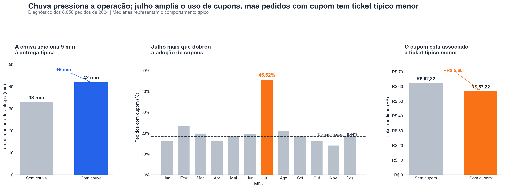

# Chuva atrasa entregas, derruba avaliações e exige cautela no uso de cupons: diagnóstico de 2024

> A chuva acrescenta 9 minutos à entrega típica e atrasos reduzem a avaliação; para 2025, a empresa deve reforçar a operação em dias chuvosos e redesenhar cupons para gerar valor incremental.



*Painéis: tempo mediano com e sem chuva, taxa mensal de uso de cupons e ticket mediano com e sem cupom. Base tratada com 8.058 pedidos de 2024.*

---

## 1. Pergunta de negócio

A diretoria do app solicitou um diagnóstico de 2024 para apoiar o planejamento e o orçamento de 2025. A análise investigou três frentes: operação, com foco em volume, tempo e atrasos; clientes, considerando ticket e avaliação; e alavancas do negócio, com atenção aos cupons, à campanha “Julho de cupons” e à chuva.

**Perguntas que guiaram a análise:**

1. Em quais dias da semana e horários ocorre a maior concentração de pedidos em cada cidade?
2. Como o tempo de entrega varia entre São Paulo, Rio de Janeiro e Belo Horizonte e conforme a distância do pedido?
3. Clientes novos apresentam ticket e avaliação diferentes dos demais clientes?
4. Pedidos com cupom possuem ticket diferente dos pedidos sem cupom e esse comportamento mudou durante a campanha “Julho de cupons”?
5. Em dias de chuva, as entregas levam mais tempo do que em dias sem chuva?

## 2. Dados

- **Fonte:** `delivery_pedidos.csv`, fornecida no módulo DS-PY-018, com dados simulados de um app de delivery.
- **Período e escopo:** 01/01/2024 a 31/12/2024; São Paulo, Rio de Janeiro e Belo Horizonte.
- **Tamanho:** 8.058 × 18 na base original → 8.058 × 23 na base limpa publicada.
- **Unidade de observação:** um pedido.

### Dicionário da base limpa (`saidas/delivery_pedidos_limpo.csv`)

| Coluna | Tipo | Descrição | % faltantes | Observação / tratamento |
|---|---|---|---:|---|
| `pedido_id` | int64 | Identificador do pedido | 0,00% | Identificador único; não houve repetição |
| `data_hora` | datetime64 | Data e hora do pedido | 0,00% | Convertida de texto; nenhuma data inválida |
| `cidade` | object | Cidade de entrega | 0,00% | 13 grafias padronizadas para 3 cidades |
| `bairro` | object | Bairro de entrega | 0,00% | Mantido como informado |
| `restaurante_id` | object | Identificador do restaurante | 0,00% | Mantido como informado |
| `tipo_cozinha` | object | Tipo de cozinha | 0,00% | Seis categorias |
| `plataforma` | object | Plataforma do pedido | 0,00% | 153 faltantes classificados como `Não informado` |
| `forma_pagamento` | object | Forma de pagamento | 0,00% | 8 grafias padronizadas para 4 categorias |
| `cupom` | bool | Indica uso de cupom | 0,00% | `Sim`/`Não` convertidos para `True`/`False` |
| `cliente_novo` | bool | Indica primeiro pedido do cliente | 0,00% | Mantida como booleana |
| `chuva` | bool | Indica chuva na cidade naquele dia | 0,00% | Mantida como booleana |
| `distancia_km` | float64 | Distância entre restaurante e cliente | 4,00% | 315 faltantes originais e 7 valores acima de 100 km tratados como `NaN` |
| `tempo_entrega_min` | float64 | Minutos entre pedido e entrega | 0,41% | 25 códigos `999` e 8 negativos tratados como `NaN` |
| `valor_pedido` | float64 | Valor dos itens, sem taxa, em reais | 0,00% | Símbolo `R$` e vírgula decimal removidos; conversão sem perda |
| `taxa_entrega` | float64 | Taxa de entrega cobrada, em reais | 0,00% | Valores iguais a zero mantidos como frete grátis |
| `avaliacao` | float64 | Nota de 1 a 5 atribuída pelo cliente | 16,65% | Ausência mantida, pois a avaliação é opcional |
| `data` | object | Data do pedido, sem horário | 0,00% | Derivada de `data_hora` |
| `mes` | int32 | Mês do pedido, de 1 a 12 | 0,00% | Derivada de `data_hora` |
| `hora` | int32 | Hora do pedido, de 0 a 23 | 0,00% | Derivada de `data_hora` |
| `dia_semana` | category | Dia da semana abreviado | 0,00% | Categoria ordenada de `Seg` a `Dom` |
| `tempo_invalido` | bool | Flag de tempo inválido | 0,00% | `True` para códigos `999` ou tempos negativos |
| `distancia_invalida` | bool | Flag de distância inválida | 0,00% | `True` para as 7 distâncias acima de 100 km |
| `pedido_grande` | bool | Flag de pedido excepcionalmente grande | 0,00% | `True` acima do salto da razão ticket/mediana da cozinha; 1 pedido |

## 3. Como rodar

```bash
git clone URL_DO_REPOSITORIO
cd PASTA_DO_REPOSITORIO
python -m venv .venv
# Linux/macOS: source .venv/bin/activate
# Windows: .venv\Scripts\activate
pip install -r requirements.txt
jupyter notebook projeto_final.ipynb
```

- O notebook deve ler o CSV original em `dados/delivery_pedidos.csv`; coloque o arquivo nessa pasta sem editá-lo.
- Execute **Kernel → Restart & Run All** e confirme que todos os checkpoints terminam sem erro.
- As versões de Python, pandas, seaborn, matplotlib e scipy devem ser registradas no `requirements.txt` gerado no mesmo ambiente da execução.

## 4. Estrutura do repositório

```text
.
├── README.md
├── requirements.txt
├── projeto_final.ipynb
├── autoavaliacao.md
├── dados/
│   └── delivery_pedidos.csv
└── saidas/
    ├── delivery_pedidos_limpo.csv
    └── figura_principal.png
```

## 5. Metodologia

1. **Perguntas e hipóteses** — As perguntas foram organizadas nas frentes de operação, clientes e alavancas, com seis hipóteses testáveis.
2. **Carga e inspeção** — Foram identificados tipos inadequados em `data_hora` e `valor_pedido`, duas colunas constantes, três colunas com faltantes e valores impossíveis em tempo e distância.
3. **Limpeza** — Datas e valores monetários foram convertidos, cidades e pagamentos padronizados, cupons convertidos para booleano e faltantes tratados sem remover linhas.
4. **Outliers** — Foram tratados como erros 33 tempos inválidos e 7 distâncias acima de 100 km; pedidos de valor elevado foram mantidos quando plausíveis.
5. **Estatística descritiva** — Foram utilizadas medidas robustas, principalmente a mediana, porque o ticket apresentou assimetria de 17,52.
6. **Sumarização e granularidade** — As análises por pedido, cidade-dia, dia, semana e mês revelaram picos operacionais, chuva, crescimento e efeito da campanha de julho.
7. **Visualização** — Foi adotada uma paleta consistente, títulos-conclusão, unidades nos eixos e destaque apenas para os dados centrais.
8. **Correlação** — Pearson e Spearman foram comparados; chuva deslocou a relação distância-tempo, e frete grátis explicou a correlação moderada entre distância e taxa.
9. **Testes de hipótese** — Foram aplicados Mann-Whitney, Spearman, Kruskal-Wallis, ANOVA e qui-quadrado, com α = 5% e tamanho de efeito.
10. **Conclusões** — Os resultados foram convertidos em cinco achados, três recomendações acionáveis e limitações explícitas.

### Decisões de limpeza

| Problema | Linhas afetadas | Decisão | Alternativa considerada |
|---|---:|---|---|
| `tempo_entrega_min` = 999 | 25 | Converter para `NaN` e marcar `tempo_invalido` | Remover os pedidos |
| `tempo_entrega_min` negativo | 8 | Converter para `NaN` e marcar `tempo_invalido` | Remover os pedidos |
| Distâncias incompatíveis com a operação | 7 | Valores acima de 100 km convertidos para `NaN` e marcados em `distancia_invalida` | Remover todos os 194 outliers do IQR |
| Faltantes em `distancia_km` | 315 | Manter como `NaN` | Imputar pela relação com a taxa de entrega |
| Faltantes em `avaliacao` | 1.342 | Manter como `NaN`, pois a avaliação é opcional | Preencher com média ou mediana |
| Faltantes em `plataforma` | 153 | Classificar como `Não informado` | Usar a moda |
| Categorias inconsistentes em `cidade` | 997 | Padronizar para 3 cidades | Manter grafias separadas |
| Categorias inconsistentes em `forma_pagamento` | 666 | Padronizar para 4 formas | Manter grafias separadas |
| Colunas constantes | 8.058 em cada coluna | Remover `pais` e `moeda` | Manter sem uso analítico |

## 6. Principais achados

1. **A chuva elevou o tempo mediano de entrega de 33 para 42 minutos.** O aumento de 9 minutos foi confirmado pelo Mann-Whitney na Tarefa 9.1 e importa porque exige reforço operacional e revisão da promessa de prazo em dias chuvosos.
2. **1.476 pedidos, ou 18,39% dos pedidos com tempo válido, ultrapassaram 45 minutos.** A métrica vem da Tarefa 5.4 e mostra que quase 1 em cada 5 entregas quebraria uma promessa de entrega em até 45 minutos.
3. **Pedidos acima de 35 minutos tiveram avaliação média de 4,203, contra 4,488 nos pedidos entregues em até 35 minutos.** A queda de 0,285 ponto foi confirmada por Spearman e Mann-Whitney na Tarefa 9.3 e importa porque atrasos estão associados à piora da satisfação.
4. **Em julho, 45,62% dos pedidos usaram cupom, contra 18,44% nos demais meses.** A diferença de 27,18 pontos percentuais foi confirmada pelo qui-quadrado na Tarefa 9.6 e mostra que a campanha esteve associada a forte aumento no uso do benefício.
5. **Pedidos com cupom tiveram ticket mediano de R$ 57,22, contra R$ 62,82 sem cupom.** A diferença de R$ 5,60 foi confirmada pelo Mann-Whitney na Tarefa 9.2 e importa porque o maior uso de cupons não esteve associado a ticket típico maior.

### Hipóteses testadas (α = 5%)

| Hipótese | Teste | p-valor | Efeito | Decisão | Em linguagem de negócio |
|---|---|---:|---|---|---|
| H1 chuva × tempo de entrega | Mann-Whitney unilateral | 6,21 × 10⁻²⁵⁶ | +9 min | Rejeitar H0 | A chuva aumenta de forma relevante o tempo típico de entrega |
| H2 cupom × ticket | Mann-Whitney bilateral | 3,19 × 10⁻¹⁴ | −R$ 5,60 na mediana | Rejeitar H0 | Pedidos com cupom têm ticket típico menor |
| H3 tempo × avaliação | Spearman + Mann-Whitney | 7,75 × 10⁻⁹²; 6,32 × 10⁻⁶² | ρ = −0,244; −0,285 ponto acima de 35 min | Rejeitar H0 | Entregas mais demoradas tendem a receber notas menores |
| H4 cozinha × ticket | Kruskal-Wallis + ANOVA | < 1 × 10⁻³⁰⁰; 2,94 × 10⁻²⁸³ | ε² = 0,406; η² = 0,151; amplitude mediana = R$ 69,55 | Rejeitar H0 | O tipo de cozinha explica diferenças relevantes no ticket |
| H5 cidade × forma de pagamento | Qui-quadrado | 0,6951 | V de Cramér = 0,0155 | Não rejeitar H0 | As cidades apresentam padrões de pagamento semelhantes |
| H6 julho × uso de cupom | Qui-quadrado com controle por `cliente_novo` | 1,29 × 10⁻⁷² | +27,18 p.p.; V de Cramér = 0,2008 | Rejeitar H0 | Julho teve uso de cupom muito superior aos demais meses, inclusive por perfil de cliente |

## 7. Recomendações

| # | Recomendação | Achados que sustentam | Métrica para acompanhar |
|---:|---|---|---|
| 1 | Reforçar entregadores e ajustar a previsão de prazo nos dias chuvosos | Chuva acrescenta 9 min; 18,39% das entregas superam 45 min | Mediana do tempo na chuva e % acima de 45 min |
| 2 | Priorizar pedidos próximos de 35 min e criar alertas operacionais antes do atraso | Acima de 35 min, a avaliação média cai 0,285 ponto | % entregue em até 35 min e avaliação média acima de 35 min |
| 3 | Testar cupons com valor mínimo e foco em aquisição incremental | Uso chegou a 45,62% em julho, mas o ticket mediano com cupom foi R$ 5,60 menor | Taxa de uso, ticket mediano com cupom e % de clientes novos |

## 8. Limitações

- A base é observacional: associações entre chuva, cupons, tempo e avaliação não comprovam causalidade.
- Não há informações de trânsito, disponibilidade de entregadores, tempo de preparo, quantidade de itens ou custo dos cupons.
- A avaliação é opcional e está ausente em 16,65% dos pedidos, portanto pode existir viés de resposta.
- A base contém apenas 2024 e três cidades, limitando a generalização para outros períodos e operações.
- Não existe `cliente_id`, o que impede análises de recorrência, retenção e valor do cliente ao longo do tempo.

## 9. Próximos passos

- Executar testes controlados de cupons, registrando custo, margem, valor mínimo e conversão de clientes novos em recorrentes.
- Incorporar trânsito, tempo de preparo, disponibilidade de entregadores e previsão de chuva para modelar atrasos e ajustar prazos dinamicamente.
- Adicionar `cliente_id` anonimizado e quantidade de itens para analisar retenção, frequência, ticket e pedidos corporativos.

## 10. Autores

| Nome | GitHub | Principais contribuições |
|---|---|---|
| Cleisson Nascimento | A preencher | Análise completa, limpeza, hipóteses, visualizações e README |

*Projeto final do módulo DS-PY-018 · Análise Exploratória de Dados · turma 1735 11/2026*
